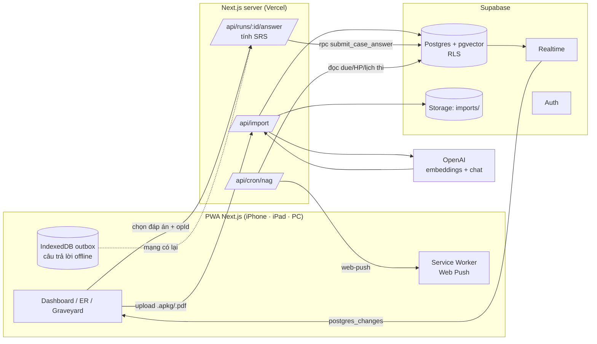
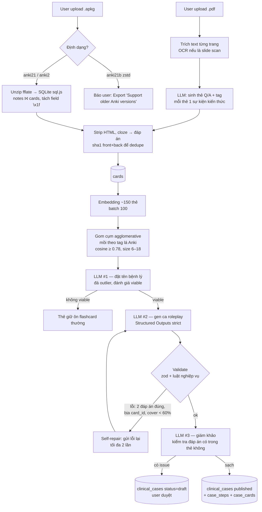

# Kiến trúc — Con Bệnh Cấp Cứu

## 1. Tổng quan

| Lớp | Lựa chọn | Lý do |
|---|---|---|
| Frontend | Next.js 15 App Router + Tailwind, PWA | 1 codebase cho điện thoại / iPad / PC; iOS ≥ 16.4 nhận Web Push khi "Thêm vào MH chính" |
| DB / Sync | Supabase (Postgres, Realtime, Auth, Storage) | SRS là dữ liệu quan hệ + cần transaction; Realtime miễn phí cho đồng bộ đa thiết bị |
| AI | OpenAI `text-embedding-3-small` + chat model Structured Outputs | Embedding để gom cụm rẻ; JSON schema strict để gen case không vỡ format |
| Push | `web-push` (VAPID) + cron 30 phút | Không phụ thuộc FCM/APNs riêng |

## 2. Luồng AI: file Anki → ca lâm sàng

Prompt ngầm nằm ở [`src/lib/ai/prompts.ts`](../src/lib/ai/prompts.ts). Ý chính:
- **Mỗi đáp án đúng phải truy được về mặt sau của thẻ** trong `card_ids` của bước đó → mỗi bước là một "gói" thẻ Anki, chấm SRS cho đúng những thẻ đó.
- Cấm bịa liều thuốc/ngưỡng xét nghiệm không có trong thẻ.
- Rationale giọng chuyên môn; phần chửi do app lo (tách bạch kiến thức và trò đùa).
- `hp_penalty` tỷ lệ với nguy hiểm thật (sai đường thở > sai kháng sinh).
- `prompt_version` lưu vào DB để biết case nào cần gen lại khi đổi prompt.

## 3. Gameplay ↔ SRS

| Hành động | Rating | Tác động |
|---|---|---|
| Đúng, < 8s | `easy` | interval × ease × 1.3 |
| Đúng | `good` | interval × ease |
| Đúng, > 45s | `hard` | interval × 1.2, ease −0.15 |
| Sai | `again` | lapse → relearning 10 phút, ease −0.2, **HP −penalty** |

- 1 lựa chọn = rating cho **tất cả** `card_ids` của bước.
- Lịch ôn bị **kẹp trước ngày thi 1 ngày** (`clampToExam`) — ôn sau khi thi xong là vô nghĩa.
- HP về 0 → `run.status = dead` → trigger trong RPC dựng `tombstones` với `cause_card_ids` = các thẻ sai trong lượt.
- **Thắp nhang**: ôn lại từng thẻ trong `cause_card_ids` ở dạng flashcard; trả lời ≥ `good` = 1 nén (`incense_offerings`). Đủ nén → `redeemed_at`.

## 4. Đồng bộ đa thiết bị

1. **Online**: mọi ghi đi qua RPC `submit_case_answer` (1 transaction: chấm, trừ HP, ghi `review_logs`, upsert `card_srs`, cập nhật profile, dựng bia mộ). Các thiết bị khác nhận thay đổi qua Supabase Realtime (`card_srs`, `case_runs`, `exams`, `profiles`, `tombstones`, `import_jobs`).
2. **Offline**: client sinh `opId` (UUID), lưu vào outbox IndexedDB, chấm local để chơi tiếp. Có mạng thì flush outbox; `review_logs.unique(client_op_id, card_id)` + check đầu RPC ⇒ gửi lại không tính trùng.
3. **Xung đột**: `card_srs` dùng *last-write-wins theo `reviewed_at` của client* (không theo giờ server nhận) — ôn trên iPad lúc 22h offline, sync lúc 23h vẫn không đè lần ôn 22h30 trên PC.
4. **Hai máy cùng chơi 1 ca**: RPC khoá `case_runs FOR UPDATE` và kiểm tra `step_order = current_step` → máy bấm sau nhận `409 STEP_OUT_OF_ORDER`, reload state.
5. **Thiết bị vắng lâu**: kéo `sync_events where id > devices.last_pulled_event` (change feed do trigger ghi) thay vì tải lại toàn bộ.

## 5. Push notification

`/api/cron/nag` (mỗi 30 phút) → với từng user: bỏ qua giờ yên lặng (`quiet_hours`), giới hạn 1 lần / 3 giờ, dựng `NagContext` (thẻ đến hạn, HP ca đang dở, ngày tới kỳ thi, mộ chưa thắp, streak) → `pickNag` chọn template có trọng số theo `nag_level` (0 hiền … 3 cục súc). Subscription 404/410 tự dọn.

## 6. Đã có / giới hạn còn lại

Đã có: đăng nhập OTP email, đăng ký thiết bị + Web Push, outbox IndexedDB (gửi lại đúng thứ tự khi có mạng),
chơi tiếp ca trên máy khác, nghĩa trang + thắp nhang, duyệt ca nháp, import `.apkg` (cả `anki21b` zstd) và `.pdf` có text,
lịch thi YVD nạp sẵn khi đăng ký, CI chạy unit test + migration + smoke test SQL.

Giới hạn:
- PDF toàn ảnh scan không trích được chữ → báo số trang lỗi, chưa OCR.
- Pipeline gen chạy trong `after()` của route (tối đa `maxDuration = 300s`). Deck rất lớn (> ~300 thẻ) nên tách file hoặc chuyển sang queue (Inngest / Supabase Edge Function).
- Media (ảnh) trong thẻ Anki được thay bằng `[hình]`.
